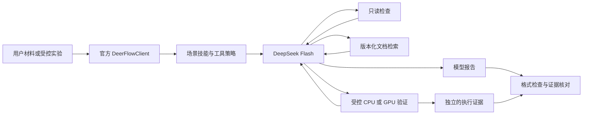

# 项目结构与贡献边界

项目名称：基于 DeerFlow 的大模型实验诊断与验证助手。

## 主体架构

用户材料入口只允许 C/R，不允许 V；V 只对固定、可审查的开发实验开放。Python 子进程不是安全隔离边界。

## 应优先理解的代码

| 文件 | 作用 |
|---|---|
| analyze_materials.py | 用户 JSON/目录输入的官方框架入口 |
| agent_server.py / console/ | 单用户页面、受限任务队列、每任务独立进程 |
| experiment_diagnostics/job_storage.py | 原子任务元数据、单写者文件锁、重启后保留完成结果；不自动重试中断任务 |
| bootstrap_runtime.py / deploy/agent/ | 按平台哈希锁安装独立环境、服务器及 Docker 迁移准备 |
| experiment_diagnostics/materials.py | 明确文件选择、脱敏、静态分析、日志行号 |
| deerflow_case/material_policy.py | 通过官方中间件钩子过滤和拒绝不允许的工具 |
| deerflow_case/material_tools.py | 检查材料及按版本检索，不执行提交代码 |
| run_multistep.py | 多故障官方框架入口及执行证据评分 |
| run_recipe.py / check_recipe.py | 操作者选定 JSON 配置的执行入口及无 API 数据预检 |
| deerflow_case/recipe_spec.py / recipe_tools.py / recipe_worker.py | 数据和资源契约、累积配置变化、固定 CPU 重跑；原始输入不改写 |
| deerflow_case/model_profile.py | 加载前限制受支持的预训练模型配置与本地权重格式 |
| deerflow_case/multistep_tools.py | 累积修复、版本检查、缓存、异常回滚 |
| deerflow_case/multistep_worker.py | 固定微型 CPU 实验，实际失败与重跑 |
| run_pretrained.py / deerflow_case/pretrained_worker.py | 已有本地预训练权重的固定 GPU 两步验证 |
| experiment_diagnostics/knowledge.py | BM25 检索、版本过滤、文档行号引用 |
| experiment_diagnostics/citations.py | 声明引用与本次实际检索结果核对，不评估语义支持 |
| experiment_diagnostics/provenance.py | 场景源码快照、技能与索引哈希、运行中变更检查 |
| experiment_diagnostics/model_output.py | JSON 格式检查和显式恢复，不自行证明修复成功 |
| compare_materials.py | 同模型直接回答与完整 Agent 路径的对照 |
| compare_multistep.py | 相同工具、技能、反馈和最大调用次数的工具 Agent 对照 |

## 多步骤状态为什么需要自己实现

DeerFlow 管理模型与工具的执行循环；本项目仍需定义实验领域的状态语义：当前修订号、已应用修复、实际运行编号与最终是否通过。

- 每次新修复都累积到当前实验，不丢掉前次修改。
- expected_revision 与当前修订号不一致时不执行。
- 重复动作返回明确标记的先前运行结果，不冒充新执行。
- 基础设施异常回滚状态；正常的实验失败保留本次修改，让下一个错误成为新证据。
- 原子锁避免同一旧修订号的并行调用同时提交。
- 已通过的实验禁止继续修改。

成功不只看模型文字，要核对实际退出码、有限梯度、参数更新、run_id 和 revision。
新 JSON 配置路径另外核对配置 SHA-256、有限参数、资源范围，以及标签策略变化的明确披露。
修复一次后出现新错误，只能说明前一阻碍消失，不能说明实验通过。

## 谁提供了什么

- DeerFlow：官方 Agent 循环、客户端、工具装配、中间件和技能加载。当前固定 v2.0.0，核心源码未修改。
- 原 RAG 项目：纯切分和路由函数；API 向量化、重排尚未迁移。
- 本项目：实验输入协议、诊断工具、受控验证工具、状态管理、场景技能、知识资料整理、执行证据与评测。
- DeepSeek：模型推理。预定义修复动作不是模型自动编写任意训练代码。

## 目前不能声称的结果

简单错误对照没有显示质量收益，Agent 还有额外开销。
多故障案例证明本机集成能根据真实重跑继续推进；相同工具与反馈的轻量 Agent 对照也全部通过，没有证明框架质量优势。
开发回归、规则式覆盖、格式恢复都不能当作独立诊断准确率。
已有真实预训练模型 GPU 配置故障验证，不包括 OOM、QLoRA 或模型质量评测。学校服务器、官方完整网页端、较新版本兼容和 Linux/Docker 实机验证仍未完成。

## 引用与源码复现

材料报告协议版本 3 增加 references。每条声明引用必须与本次检索返回的完整 URL 和行范围一致；审计器补全来源哈希和版本适用标记。引用来自真实检索不代表它支持模型的陈述，也不证明报告没有遗漏引用。

后续材料、多故障和预训练运行在开始前复制允许的场景源码、技能与知识清单到运行目录的 provenance/，记录依赖版本和索引哈希；结束时核对运行中是否变化。环境变量、用户原文件和权重不进入此源码快照。旧结果不补造快照，这也不是完整环境镜像或上游签名验证。
